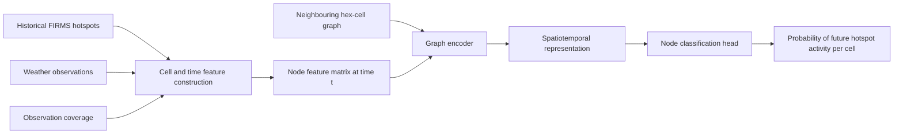

# Spatiotemporal Hotspot Forecasting

This document defines the first version of the forecasting problem. It is a working draft; the region, grid resolution, target window, and final model are still open.

## Problem definition

Given weather and recent hotspot information available up to time `t`, predict future hotspot activity in each spatial cell during a later window.

The first target is:

> **Future hotspot activity:** whether at least one qualifying FIRMS hotspot is detected in a cell during the prediction window.

This target does not mean confirmed ignition. FIRMS provides satellite detection dates, not verified fire-start dates. A positive result can represent an ongoing fire, spread, delayed detection, or a new detection.

## Input

The study area is divided into neighbouring hexagonal cells. Each cell becomes a graph node. For each prediction time, the node receives features calculated only from information available before that time.

Candidate node inputs include:

- Previous 1-, 3-, and 7-day hotspot counts.
- Previous hotspot FRP sum, maximum FRP, and detection count.
- Time since the most recent hotspot in the cell.
- Recent hotspot activity in neighbouring cells.
- Temperature summaries over the previous 3 and 7 days.
- Rainfall totals and dry-day counts over the previous 3 and 7 days.
- Relative humidity and wind summaries where coverage and definitions are suitable.
- Fire Weather Index variables if reliable coverage is confirmed.
- Month or day-of-year indicators.
- Weather-station availability and observation-coverage indicators.

The graph structure connects neighbouring cells. The current plan is to test a hexagonal grid first; the cell resolution remains undecided.

## Model diagram



## Model

The graph model receives a feature vector for every cell and uses edges between neighbouring cells to share spatial information. A temporal component can process the sequence of recent observations or receive rolling 3-day and 7-day features.

The planned comparison is:

1. Cell-only baseline using each cell's own features.
2. Baseline with neighbouring-cell summary features.
3. Standard graph neural network.
4. Graph foundation model with a classification head, if the selected model accepts this graph format.

The comparison will show whether graph structure and pretraining add value beyond simpler models.

## Output

For each cell and prediction time, the model produces:

```text
probability(cell has future hotspot activity)
```

These probabilities can be displayed as a spatial risk map or converted into alerts using a selected threshold.

The initial task is binary node classification:

```text
0 = no qualifying hotspot detected during the future window,
    where observation coverage supports a negative label
1 = at least one qualifying hotspot detected during the future window
unknown = coverage is insufficient to assign a reliable label
```

## Time setup

Features use information available through time `t`. The label looks forward from `t`.

| Component | Initial candidates |
| --- | --- |
| Feature history | Previous 3 days and previous 7 days |
| Prediction horizon | Next 1 day, then compare 3-day and 7-day windows |
| Development years | 2021–2023 |
| Final test year | 2024 |

Prediction windows must not cross the boundaries between training, validation, and final testing periods.

## Open decisions

- Final study region.
- Hex-cell system and resolution.
- Definition of a qualifying hotspot.
- Negative-label and observation-coverage rules.
- Whether the target should remain future hotspot activity or use incident records for new-fire occurrence.
- Graph foundation model and input format.
- Evaluation metrics and alert threshold.

