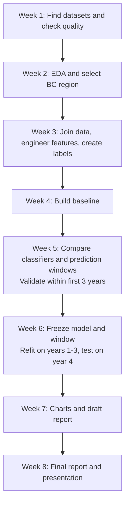

# Wildfire Forecast: 8-Week Roadmap

## Goal

Explore wildfire and weather data, then build a time-based binary classification model to predict wildfire occurrence in one region of British Columbia using a fixed historical dataset.

## Background

Key takeaways from [CanadaFireSat (Porta et al., 2026)](../wildfire_paper_usingimage_data.pdf), Introduction, pp. 556-557:

- Wildfire occurrence depends on weather, available vegetation/fuel, fuel moisture, and ignition from lightning or human activity. Dry conditions alone do not guarantee a fire.
- Fire Weather Index (FWI) describes conditions favorable for burning; it is not itself a probability of ignition.
- Model performance depends on the region, predictors, and forecast window, supporting our plan to determine the window experimentally.

For our structured-data project, these points motivate testing weather, moisture indices, and historical fire patterns together. The paper uses satellite imagery; we are borrowing domain insights rather than reproducing its method.

## Data

- Historical wildfire records: dates and locations.
- Daily weather: temperature, rainfall, humidity, and wind.

Use four years of data (years TBD): train on the first three years and test on the fourth. Use time-based validation within the training years to choose features and the prediction window; keep the fourth year untouched for final testing.

## Modeling approach

After EDA, build one row per date for the selected region, with weather summaries, rolling rainfall, dry spells, and past fire counts. Label each row `1` if a new wildfire is recorded within the following prediction window, otherwise `0`. Determine the window experimentally using training and validation data.

Start with logistic regression or a tree-based classifier. The dataset is static, but rows remain in time order; a specialized time-series model is optional. Only label dates with complete fire-record coverage for the full window, and exclude rows whose label windows cross training, validation, or test boundaries.

## Team responsibilities

- **William:** gather domain knowledge to guide features and interpretation.
- **Arsh and Gurleen:** source datasets and perform EDA.

## Weekly milestones

| Week | Work | Deliverable |
| --- | --- | --- |
| 1 | Find datasets and check their quality. | Data summary |
| 2 | Explore fire patterns and weather; choose one BC region. | EDA notebook and selected region |
| 3 | Clean and join sources, engineer time-based features, and create labels for candidate prediction windows. | Labeled daily dataset |
| 4 | Build a simple baseline using historical fire frequency. | Baseline results |
| 5 | Train simple classifiers and compare prediction windows using time-based validation within the first three years. | Model and prediction-window comparison |
| 6 | Freeze the model and prediction window, refit on the first three years, then test on the fourth year. | Final evaluation |
| 7 | Create clear charts and prepare the final report. | Draft report and demo notebook |
| 8 | Finish documentation and present findings. | Final report and presentation |

## Keep it simple

- One region and historical data only; prediction window chosen through experiments.
- Use earlier dates for training and later dates for evaluation.
- Use only information available at the time each prediction is made.
- Compare the model with the baseline using precision and recall.
- No fire-spread simulation, live alerts, or web app.

## Final outcome

TBD
